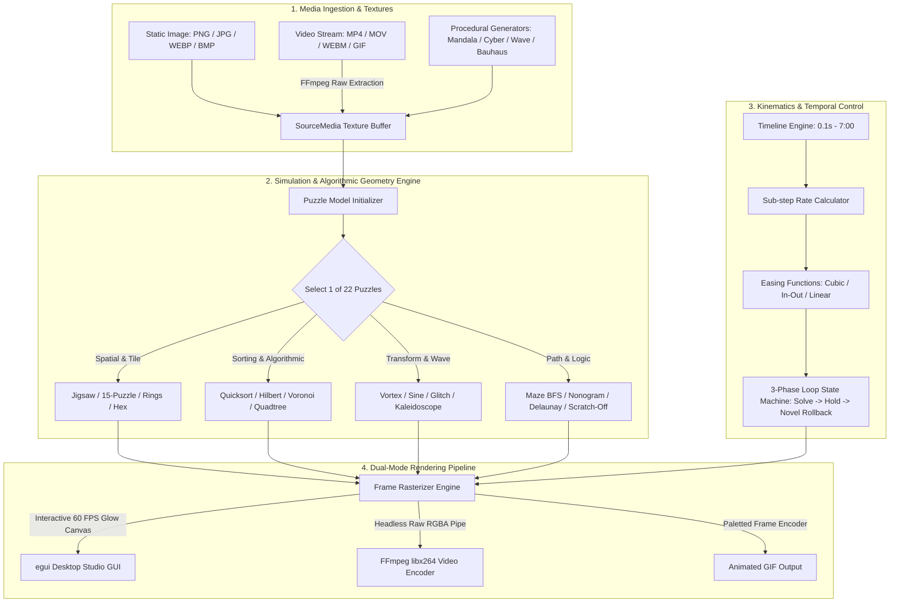

# 🎬 Video-Solver Studio
### *Generative Algorithmic Puzzle & Video Synthesis Engine*

[](https://www.rust-lang.org/)
[](https://github.com/emilk/egui)
[](https://github.com/rayon-rs/rayon)
[](https://ffmpeg.org/)
[](#)
[](#automated-testing--verification)
[](#)

A high-performance creative coding studio and procedural video synthesis suite built in native Rust. **Video-Solver** deconstructs static images and dynamic video streams into **22 distinct mathematical and geometric puzzle simulations**, animating their resolution in real time at **60 FPS** or exporting cinematic **H.264 MP4** and animated **GIF** media via pipe IPC streaming.

---

```
┌────────────────────────────────────────────────────────────────────────────────────────┐
│                                 STUDIO PREVIEW CANVAS                                  │
│   [ Mandala / Custom Media ] ──> [ Algorithmic Decomposition ] ──> [ Kinematic Solve ] │
│                                                                                        │
│   ▶ Play/Pause   [ 0:00 ━━━━●━━━━━━━━━━━━━━━━━━━━━━━━━━━━━ 7:00 ]   Rate: 14.2 moves/s │
└────────────────────────────────────────────────────────────────────────────────────────┘
```
> *Interactive 60 FPS egui canvas featuring real-time timeline scrubbing, live video texture mapping, and multi-phase kinematic rollback loops.*

---

## 🌟 Developer Profile & Engineering Highlights

This project serves as a showcase of systems programming in **Rust**, real-time graphics rendering, computational geometry, and multi-threaded media pipelines:

- **Computational Geometry & Algorithmic Breadth**: Implements 22 distinct algorithmic models from scratch, including Voronoi diagrams, Delaunay triangulations, recursive space-filling Hilbert curves, graph-theoretic BFS maze generation, quadtree spatial partitioning, and Quicksort sorting network visualizers.
- **Immediate-Mode UI Ergonomics (`egui` / `eframe`)**: Zero-latency interactive studio with 60 FPS live playback, arbitrary precision timeline scrubbing (`0:00` to `7:00`), dynamic zoom/panning, and interactive procedural parameter controls.
- **Dynamic Video-on-Geometry Texture Streaming**: Video files (`.mp4`, `.mov`, `.webm`, `.gif`) are decoded and mapped onto moving, rotating puzzle pieces in real time, supporting continuous (`0 → 100`) and bounce ping-pong (`0 → 100 → 0`) playback modes.
- **Zero-Copy Media Streaming IPC**: Employs an uncompressed raw RGBA byte-pipe directly into spawned `ffmpeg` sub-processes (`libx264`, `yuv420p`, `+faststart`), avoiding intermediate disk write bottlenecks.
- **Kinematic Reverser & Novel Roll-Back Loops**: Rather than simple reverse video playback, the engine computes novel 3-phase physics trajectories (centrifugal disassemblies, parabolic loft flight paths) that return fragments seamlessly to their initial scrambled state for infinite looping.
- **Robust Parallel Processing (`rayon`)**: Multi-core batch rendering and procedural image generation with atomic progress reporting and graceful thread cancellation.

---

## 🏛️ System Architecture



---

## 🧩 Algorithmic Showcase & Gallery (The 22 Solvers)

The 22 puzzle simulations are organized into four mathematical domains:

### 1. Spatial & Tile Dynamics
Simulations exploring 2D rigid-body kinematics, tiling topologies, and geometric permutations.

| # | Puzzle | Core Algorithm & Mathematics | Visual Dynamic |
|---|---|---|---|
| **01** | **Classic Jigsaw** | Parametric cubic Bézier tab/blank boundary generation with randomized spatial displacement vectors $\vec{v} \in \mathbb{R}^2$ and rotational scatter $\theta \in [-\pi, \pi]$. | Pieces glide along damped cubic trajectories, locking into neighboring contours. |
| **02** | **Sliding 15-Puzzle** | $N \times N$ grid inversion parity verification ($N_{\text{inv}} \equiv 0 \pmod 2$), scrambled via random walk permutations and solved via exact shortest path reversal. | Discrete tile transitions sliding through the vacant cell slot. |
| **03** | **Tile Permutation Swap** | Cyclic permutation decomposition $\sigma \in S_n$ decomposed into transposition cycles. | Scrambled image tiles arc across the canvas along 3D-projected parabolic loft trajectories. |
| **04** | **Rotating Tile Grid** | Discrete cyclic group $C_4$ rotational symmetry ($k \cdot 90^\circ, k \in \{1, 2, 3\}$). | Grid segments spin simultaneously or sequentially with torsional deceleration. |
| **05** | **Concentric Rotating Rings** | Polar coordinate mapping $(r, \theta)$ with variable angular velocity $\omega(r)$ per concentric annular radius. | Alternating counter-rotating rings un-twist from center outward into visual alignment. |
| **06** | **Toroidal Rubik Shift** | Flat 2-torus $\mathbb{T}^2 \cong \mathbb{R}^2 / \mathbb{Z}^2$ cyclic wrap shifts across rows and columns. | Row and column ribbons wrap cyclically across canvas borders into solved order. |
| **07** | **Hexagonal Honeycomb** | Regular hexagonal grid tessellation with axial coordinate mapping $(q, r)$. | Hexagonal tiles disperse radially into a halo and converge inward into lock. |
| **08** | **Triangular Mesh** | Equilateral triangular simplicial tiling with alternating coordinate parity. | Triangular facets rotate and translate across dual triangular axes. |

---

### 2. Sorting & Algorithmic Geometry
Visualizations of space-filling curves, partitioning algorithms, and computational geometry.

| # | Puzzle | Core Algorithm & Mathematics | Visual Dynamic |
|---|---|---|---|
| **09** | **Quicksort Image Strips** | Lomuto / Hoare recursive partitioning with dynamic pivot selection and element swap tracking. | Image slices swap algorithmically while pivot indices glow with active comparator highlights. |
| **10** | **Hilbert Curve Unfold** | Recursive discrete space-filling Hilbert curve $H_k: [0, 1] \to [0, 1]^2$, projecting 1D linear sequences to 2D locality. | A continuous ribbon serpentines along the space-filling path, folding into the coherent picture. |
| **11** | **Voronoi Shattered Glass** | Fortune's sweep-line Voronoi cell generation with Lloyd relaxation for organic shard distribution. | Explosive shard dispersal with angular impulse returning along deceleration curves. |
| **12** | **Quadtree Recursive Split** | Hierarchical 2D space partitioning tree up to depth $d_{\text{max}}$, clustering pixels by color variance. | Coarse solid blocks recursively subdivide into four quadrants down to pixel fidelity. |

---

### 3. Transform & Wave Signal Dynamics
Simulations rooted in signal processing, non-linear optics, and harmonic spatial transforms.

| # | Puzzle | Core Algorithm & Mathematics | Visual Dynamic |
|---|---|---|---|
| **13** | **Swirl Vortex Unwind** | Non-linear angular torsion $\theta'(r) = \theta + \alpha \cdot \exp(-r / \lambda)$ in polar space. | A whirlpool spiral vortex smoothly unwinds its angular twist back to Cartesian geometry. |
| **14** | **Sine Wave Phase Alignment** | Multi-frequency harmonic spatial deformation $y'(x) = y + \sum_i A_i \sin(k_i x + \phi_i)$. | Sinusoidal horizontal displacement ribbons harmonize and flatten into phase alignment. |
| **15** | **Kaleidoscope Mirror Unfold** | Dihedral symmetry group $D_{2n}$ reflections across radial angular wedges $\theta \in [0, \pi/n]$. | Multi-fold radial kaleidoscope reflections unfold outward to uncover the true underlying image. |
| **16** | **Chromatic & Scanline Glitch** | RGB color channel plane decoupling with high-frequency pseudorandom horizontal scanline displacement. | Jittering color aberration and television static sync together into crisp convergence. |
| **17** | **Mosaic Block Coalesce** | Multi-scale spatial box downsampling with bilinear interpolation scale convergence. | Massive macro-pixel blocks smoothly coalesce into ultra-fine high-resolution detail. |

---

### 4. Path & Logic Reveal
Mechanics inspired by combinatorial puzzles, graph traversals, and procedural revelation.

| # | Puzzle | Core Algorithm & Mathematics | Visual Dynamic |
|---|---|---|---|
| **18** | **Maze Spanning-Tree Reveal** | Randomized Kruskal / Prim minimum spanning tree labyrinth solved via Breadth-First Search (BFS). | A labyrinthine maze renders over the canvas as an illuminating BFS wavefront solves the path. |
| **19** | **Nonogram Logic Fill** | Discrete tomography constraint propagation across row and column run-length clues. | A logic grid evaluates clue vectors and stamps cells with tactile mechanical fills. |
| **20** | **Delaunay Triangulation** | Circumcircle empty-interior condition maximizing minimum angles across dynamic point sets. | Geometric wireframe edges triangulate across the image before filling with interpolated color. |
| **21** | **Scratch-Off Foil Brush** | Continuous stochastic brush trajectory modeling abrasive surface wear. | Frosted metallic foil is scraped away by an energetic sweeping brush tool. |
| **22** | **Color-by-Number Flood Fill** | K-means color quantization, edge topology extraction, and region-growing flood fill. | Numbered contour regions are systematically painted by a virtual artist palette. |

---

## ⏱️ Kinematics & Temporal Control

### 1. Dynamic Duration-to-Rate Scaling
The playback duration dictates the step frequency of the underlying solver engine:

$$
D_{\text{solve}} = \max\left(0.1, D_{\text{total}} - D_{\text{hold}}\right)
$$

$$
\text{Solve Rate} = \frac{N_{\text{steps}}}{D_{\text{solve}}} \quad \left[\frac{\text{moves}}{\text{second}}\right]
$$

- Durations range from **0.1 seconds up to 7 minutes (420.0s)** with unrounded sub-second precision.
- Sub-step progress is continuously smoothed per frame via user-selected easing curves:
  - **Cubic Ease-In-Out**: Smooth acceleration and gentle settling.
  - **Exponential Accelerate**: Rapid kinetic crescendo.
  - **Decelerate**: High initial speed settling into place.
  - **Linear**: Constant-velocity mechanical progression.

### 2. 3-Phase Seamless Roll-Back Loop
To generate infinite looping videos without abrupt cuts or simple frame reversals:

$$
S(t) = \begin{cases} 
\text{Solve}\left(\dfrac{t}{0.45}\right), & t \in [0, 0.45) \\
\text{Hold}(1.0), & t \in [0.45, 0.55) \\
\text{Rollback}\left(\dfrac{t - 0.55}{0.45}\right), & t \in [0.55, 1.0]
\end{cases}
$$

- **Phase 1 (0% – 45%)**: Forward algorithmic solution from scrambled state to completed image.
- **Phase 2 (45% – 55%)**: Solved hold duration allowing viewers to appreciate the final artwork.
- **Phase 3 (55% – 100%)**: Novel roll-back routes (e.g. center-out disassembly, parabolic loft arcs, secondary centrifugal spins) landing precisely on the original scrambled frame.

---

## 🚀 Quickstart

### Prerequisites
- [Rust toolchain](https://rustup.rs/) (edition 2021 or newer)
- [FFmpeg](https://ffmpeg.org/) (required for video export and video texture decoding)

```bash
# macOS
brew install ffmpeg

# Ubuntu / Debian
sudo apt install ffmpeg

# Windows (Chocolatey)
choco install ffmpeg
```

### Developer Symlink Installation (`video-solver` in PATH)
To build in release mode and symlink the binary into `/usr/local/bin/video-solver` for easy development and system-wide CLI access:

```bash
./scripts/install-dev.sh
```

Once linked, you can run `video-solver` from any directory. To remove the symlink:
```bash
sudo rm -f /usr/local/bin/video-solver
```

### 1. Launch Interactive Studio GUI
```bash
cargo run --release
```

### 2. Headless CLI Video Export
Generate high-resolution puzzle videos directly from the command line:

```bash
# Export a 7-minute Classic Jigsaw puzzle video to H.264 MP4
cargo run --release -- --cli \
  --puzzle "Classic Jigsaw" \
  --duration 7:00 \
  --complexity 12 \
  --output jigsaw.mp4

# Animate an imported video on puzzle pieces with a seamless 3-phase rollback loop
cargo run --release -- --cli \
  --input source_animation.mp4 \
  --video-loop bounce \
  --video-speed 1.0 \
  --puzzle "Voronoi Shattered Glass" \
  --duration 1:30 \
  --rollback \
  --output voronoi_loop.mp4
```

### CLI Command Reference
| Option | Argument | Description | Default |
|---|---|---|---|
| `--cli` | *flag* | Runs headless without launching the egui GUI | Disabled |
| `--input` | `<path>` | Path to image or video file (`.png`, `.jpg`, `.mp4`, `.mov`, etc.) | Procedural Mandala |
| `--puzzle` | `<name\|1-22>` | Puzzle name substring or numeric index `1..=22` | `1` |
| `--duration` | `<sec\|M:SS>` | Total video duration up to `7:00` (e.g. `5:57`, `90`, `7:00`) | `30.0` |
| `--complexity` | `<1-20>` | Puzzle density and subdivision complexity | `10` |
| `--video-loop` | `<loop\|bounce>` | Texture playback mode: `loop` ($0 \to 100$) or `bounce` ($0 \to 100 \to 0$) | `loop` |
| `--video-speed` | `<float>` | Source video playback speed multiplier (`0.5`, `1.0`, `2.0`) | `1.0` |
| `--rollback` | *flag* | Enables 3-phase seamless kinematic loop mode | Disabled |
| `--output` | `<path>` | Output destination for `.mp4` or animated `.gif` | `puzzle_output.mp4` |
| `--verify-export` | *flag* | Runs full automated verification suite across all 22 solvers | Disabled |

---

## 🧪 Automated Testing & Verification

The suite includes comprehensive unit and integration tests verifying all 22 mathematical solvers, memory safety, dynamic duration math, and export pipelines:

```bash
# Run unit and integration tests
cargo test

# Run headless verification suite (renders & verifies all 22 puzzles + MP4/GIF export pipelines)
cargo run --release -- --verify-export
```

---

## 🛠️ Tech Stack & Crates

| Crate | Version | Role in Architecture |
|---|---|---|
| [`egui`](https://crates.io/crates/egui) / [`eframe`](https://crates.io/crates/eframe) | `0.31` | Immediate-mode GUI, custom timeline scrubber, and cross-platform native viewport |
| [`rayon`](https://crates.io/crates/rayon) | `1.10` | Data-parallel multi-threading for batch processing and frame generation |
| [`image`](https://crates.io/crates/image) | `0.25` | Pixel manipulation, format decoders (PNG, JPEG, BMP, WebP), and color buffers |
| [`rand`](https://crates.io/crates/rand) / [`rand_chacha`](https://crates.io/crates/rand_chacha) | `0.8` / `0.3` | Deterministic pseudo-random number generation for repeatable seed simulations |
| [`gif`](https://crates.io/crates/gif) | `0.13` | Direct indexed-palette animated GIF encoder |
| [`rfd`](https://crates.io/crates/rfd) | `0.15` | Native asynchronous file picker dialogs |
| [`anyhow`](https://crates.io/crates/anyhow) | `1.0` | Flexible error handling across media decode and export sub-processes |

---

## 📄 License

This project is dual-licensed under either the **MIT License** or **Apache License (Version 2.0)** at your option.
